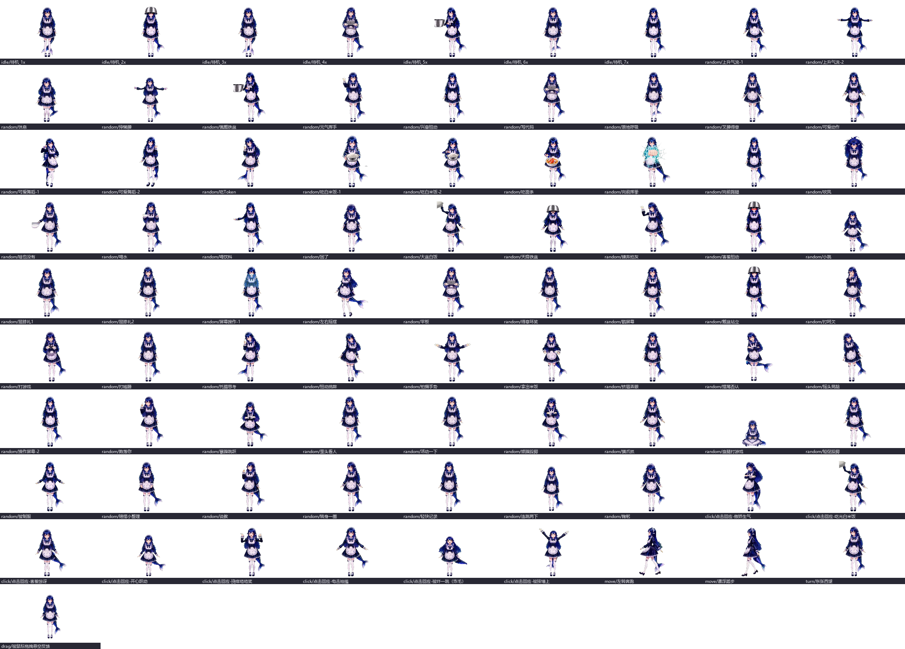

# 雌小鬼肥鱼桌宠素材包 · mesugaki

> **这是主版本（唯一维护版）。** 旧的 [`20261030`](https://github.com/MSaknussemm/20261030)（47 段 / 角色 ID `bluewhale_tv`）**已归档，不再更新**。新装只需要本仓库；两个都装也能跑，但菜单里会出现两个相似角色——只装这个更清爽。

一套给 **dsh-pet / dsh-pet-indesktop（WebM 版）** 用的桌宠角色素材：**96 段 640×360 透明动画**，合计约 **18 分钟**。丢进 `characters/` 就能换掉默认的 `shenshen`，角色 ID 是 **`mesugaki`**。

> **v1.2.x 起**：整包按同一套人体基准校准——人物身高 **310 px**、脚底 **y=351**、裙子最宽处 **92 px**。后加的 17 段 AI 素材原本比基准小 2.3%、脚底悬空 22 px、横向窄 7%，已逐段缩放对齐，切换动作时不会突然变大变小。想要未压缩的原始比例请用 `v1.0.0`。

> **v1.3.0 起**：分类重新归位，**总量仍是 82 段**，但文件名/所在目录变了——`被制服` 从 `random/` 挪进 `click/`，`开心跃动` 退回 `random/`，`待机` 收到 6 段，`drag/` 换成新剪辑 `拖拽反应`。收藏夹/书签里记着旧文件名的，对照 [`CHANGELOG.md`](CHANGELOG.md) 重新对一遍。

> **v1.4.0 起**：**总量增至 96 段**，以本地素材为唯一标准整包替换。新增 17 段（`random/` 15 段 + `events/` 2 段），`events/` 首次有内容，`idle/` 收到 5 段；`random/喝饮料`、`random/戴盆站立`、`idle/待机_2x` 换成新剪辑；移除 `random/上升气流-1`、`上升气流-2` 与 `idle/待机_6x`（后者内容并入 `待机_2x`）。逐条对照见 [`CHANGELOG.md`](CHANGELOG.md)。

> 角色参考了社区「大肥鱼 / 鲸鱼娘」的人物设计语言，但为独立角色，不是同一个人物。
> 素材以 CC BY-NC-SA 4.0 发布并保留完整署名，详见 [ASSET_LICENSE.md](ASSET_LICENSE.md)。**请勿商用。**



> 截图取自各段动画第 1.2 秒（不足 1.2 秒的取中段）。桌面上的实际大小由 `scale` 决定，默认约 0.7 倍。

---

## 和 `20261030` 的关系

同一批动画的**完整版重新发布**。旧项目（47 段精选版，角色 ID `bluewhale_tv`）保持不动，两个包可以并存，也可以只留一个。

| | 本项目 `mesugaki-whale-girl` | 旧项目 [`20261030`](https://github.com/MSaknussemm/20261030) |
|---|---|---|
| 角色 ID / 菜单名 | `mesugaki` | `bluewhale_tv` |
| 段数 | **96** | 47 |
| `random` / `click` | 78 / 7 | 29 / 8 |
| 体积 | 87.7 MB | 67.9 MB |

差异细节：

- 本项目 96 段、旧项目 47 段，**净多 49 段**：`random/` +49（78 vs 29）、`click/` −1（7 vs 8）、`events/` +2（旧项目无此分类）、`idle`/`move`/`turn`/`drag` 合计 −1。这 96 段里，15 段是早期扩充（`可爱动作`、`戳屏幕`、`托腮思考`、`扭动挑衅`、`向前挥拳`、`暴躁跳跃`、`烦躁跺脚`、`短促跺脚`、`猫爪抓`、`拿出米饭`、`挤眉弄眼`、`大盆白饭`、`吃Token`、`轻快记录`、`写代码`），17 段是 v1.2.0 新增（`吃面条`、`吃白米饭-1`、`吃白米饭-2`、`戴盆站立`、`佩戴铁盆`、`天降铁盆`、`喝饮料`、`害羞扭动`、`兴奋扭动`、`可爱舞蹈-1`、`可爱舞蹈-2`、`操作屏幕-2`、`屏幕操作-1`、`向前踢腿`、`被制服`，以及已在 v1.4.0 移除的 `上升气流-1`／`上升气流-2`），17 段是 v1.4.0 新增（`变魔术-1`、`变魔术-2`、`吃披萨`、`吃点心`、`吃饭团`、`吐泡泡`、`扑克戏法`、`换装-1`、`换装-2`、`检查鞋子`、`棒棒糖`、`灵异显示`、`玩魔方`、`看杂志`、`舒适`、`钱袋-1`、`钱袋-2`）。
- v1.3.0 把分类理了一遍（字节没变，只是换了目录/名字）：`random/被制服` → `click/点击回应-被制服`、`click/点击回应-开心跃动` → `random/开心跃动`、`drag/被鼠标拖拽悬空反馈` → `random/悬浮`、`idle/待机_6x`（原内容）→ `random/抱臂嫌弃`；原来的 `idle/待机_7x` 内容接为 `idle/待机_4x`，原来 `click/点击回应-吃白米饭` 内容接为 `idle/待机_6x`；`drag/` 换成新剪辑 `拖拽反应`（6.1 MB，比旧版 474 KB 长得多）。
- 旧项目里有 3 段在**本项目里是改名后的同一素材**（字节完全相同）：`点击回应-吃白饭` → `random/喝水`、`点击回应-头发散乱` → `random/吹风`、`random/白米饭` → `random/啥也没有`。所以点「吃白饭」的回应在本项目里变成了「随机喝水」，分类也跟着变了。
- `click/点击回应-被按墙上.webm` 与旧项目**不是同一版剪辑**：本版 630 KB / 36 fps，旧版 1.03 MB。

---

## 里面有什么

| 路径 | 内容 |
|---|---|
| `characters/mesugaki/` | 角色本体：`videos/` 七类动画 + 三个配置文件 |
| `characters/mesugaki/manifest.json` | `body_box` / `head_box`，点击与摸头的命中区（640×360 像素坐标） |
| `characters/mesugaki/move_strides.json` | 移动动画每圈的地面位移，防止「跑步像滑冰」 |
| `characters/mesugaki/text_clips.json` | 含文字的片段不做水平镜像（本角色为空） |
| `install.ps1` | Windows 一键安装 / 卸载（自动定位安装目录、先备份） |
| `tools/check_pack.py` | 素材自检：分辨率 / 帧率 / 编码 / alpha 平面 |
| `tools/make_preview.py` | 重新生成 `preview/overview.png`（自动排版、透明底格子） |
| `LICENSE` | CC BY-NC-SA 4.0 法律全文 |
| `LICENSES/MIT.txt` | 脚本（`install.ps1`、`tools/`）的 MIT 许可 |
| `preview/overview.png` | 96 段动作总览图（各段第 1.2 秒） |

> `characters/mesugaki/videos/` 下也放了同名的一份配置，**与根目录那三个文件逐字节一致**，沿用旧包的结构，不影响加载。

### 96 段动画

| 分类 | 段数 | 说明 |
|---|---|---|
| `idle/` | 5 | 待机循环，10–30 秒，按权重轮播 |
| `random/` | 78 | 随机小动作：吃白米饭、打呵欠、数落你、刷平板、盘腿打游戏、戳屏幕、托腮思考、扭动挑衅…… |
| `click/` | 7 | 点击回应：傲娇生气、害羞惊讶、炸毛、被按墙上、被制服、挠痒、电击抽搐 |
| `move/` | 2 | 漂浮踏步、左转奔跑（带 stride 标定） |
| `turn/` | 1 | 东张西望 |
| `drag/` | 1 | 拖拽反应（被鼠标拎起来时的反馈） |
| `events/` | 2 | `钱袋-1`、`钱袋-2`（v1.4.0 起有内容，余额相关小动作） |

<details>
<summary><code>random/</code> 78 段完整清单</summary>

摆尾否认、棒棒糖、抱臂嫌弃、暴躁跳跃、变魔术-1、变魔术-2、操作屏幕-2、叉腰得意、吃白米饭-1、吃白米饭-2、吃点心、吃饭团、吃面条、吃披萨、吃Token、吹风、戳屏幕、打呵欠、打瞌睡、打游戏、大盆白饭、戴盆站立、得意坏笑、短促跺脚、烦躁跺脚、害羞扭动、喝水、喝饮料、换装-1、换装-2、活动一下、挤眉弄眼、检查鞋子、鞠躬、开心跃动、看杂志、可爱动作、可爱舞蹈-1、可爱舞蹈-2、困了、连跳两下、灵异显示、猫爪抓、拿出米饭、扭动挑衅、拍摄手势、盘腿打游戏、佩戴铁盆、平板、屏幕操作-1、扑克戏法、轻快记录、屈膝礼1、屈膝礼2、裙摆小整理、啥也没有、伸懒腰、舒适、数落你、说教、天降铁盆、吐泡泡、托腮思考、歪头看人、玩魔方、嫌弃拍灰、向前挥拳、向前踢腿、小跳、写代码、兴奋扭动、休息、悬浮、摇头晃脑、元气挥手、原地呼吸、转身一圈、左右摇摆

</details>

<details>
<summary><code>idle/</code> 5 段</summary>

待机_1x、待机_2x、待机_3x、待机_4x、待机_5x

> v1.3.0 重排过：`待机_4x` 现在装的是原 `待机_7x` 的内容（952 KB），`待机_6x` 装的是原 `click/点击回应-吃白米饭` 的内容（850 KB）。桌宠按目录里有什么播什么，改的只是编号。
>
> v1.4.0 起：`待机_6x` 退出本版，其内容（850 KB）改由 **`待机_2x`** 承载；`待机` 收为 5 段。

</details>

---

## 安装

### 前提

- 已装 **dsh-pet-indesktop** 的 WebM 版（`dsh-pet-standalone-webm` / `dsh-pet-standalone-webm-chat`），
  在 Windows 上实测版本 **v4.2.1**。
- 装的是 Chat 版还是无 Chat 版都行，两者共用同一套角色目录格式。

### 方式一：脚本（Windows，推荐）

```powershell
# 先把桌宠退出（托盘图标 → 退出），再执行：
powershell -ExecutionPolicy Bypass -File .\install.ps1

# 只看它打算干什么，不动文件：
powershell -ExecutionPolicy Bypass -File .\install.ps1 -DryRun

# 装在非默认目录：
powershell -ExecutionPolicy Bypass -File .\install.ps1 -InstallDir "D:\dsh-pet"

# 卸载（把旧角色还原回来）：
powershell -ExecutionPolicy Bypass -File .\install.ps1 -Uninstall
```

脚本会：定位安装目录 → 把已有的 `mesugaki`（如果存在）整体挪到
`_internal\assets\_character-backups\mesugaki-<时间戳>\` → 复制本包的角色目录 → 打印结果。
不需要管理员权限。备份特意放在 `characters\` 外面，免得被程序当成一个角色扫进菜单。

如果检测到旧项目的 `bluewhale_tv` 还在角色目录里，脚本只会**提示**，不会替你删——菜单里会不会出现两个角色由你决定。

### 方式二：手动复制

1. 退出桌宠。
2. 找到安装目录，默认是：

   ```
   %LOCALAPPDATA%\Programs\dsh-pet-standalone-webm-chat\
   ```

   绿色版就是你解压出来的那个文件夹。

3. 把本包的 `characters\mesugaki` 整个复制到：

   ```
   <安装目录>\_internal\assets\characters\mesugaki
   ```

   最终应该是 `...\characters\mesugaki\videos\idle\待机_1x.webm` 这样的层级。

4. 启动桌宠 → **右键桌宠 → 角色 → mesugaki**。
   如果菜单里没看到，重启一次桌宠（部分版本只在启动时扫描素材目录）。
5. 大小不合适就调 `scale`（右键 → 桌宠设置）。

### 角色 ID 与改名

**目录名就是角色 ID，也就是菜单里显示的名字**。想让它在菜单里叫别的，把 `characters\mesugaki` 改成任意名字（比如 `xiaoyu`）再放进安装目录即可，`manifest.json` 不用改。

同理，想让它顶替默认角色 `shenshen`，把目录名改成 `shenshen` 覆盖掉就行——但更推荐保留 `mesugaki` 这个 ID，方便随时切回去。

### 回滚

安装脚本已经备份了同名旧目录，`-Uninstall` 会自动还原。
手动装的话，把自己覆盖前的目录拷回去即可——本包不会碰其它角色。

---

## 素材规格

想自己做片段或者二次剪辑，照这个来：

| 项 | 值 |
|---|---|
| 容器 / 编码 | WebM / **VP9 Profile 0**（`-c:v libvpx-vp9`） |
| 像素格式 | `yuva420p`（**alpha_mode=1**，带独立透明平面） |
| 分辨率 | **640×360**，SAR 1:1 |
| 帧率 | **24 fps**（94 段）；`click/点击回应-被按墙上` **36 fps**；`random/向前挥拳` **48 fps** |
| 声音 | 无（`-an`） |
| 时长 | 单段 2.5–120 秒，合计约 **1101 秒**（18.4 分钟） |
| 人物基准 | 身高 **310 px**、脚底 **y=350–351**、裙宽 **92 px**、横向约 245–395 |
| 命名 | 文件名就是菜单里显示的名字，**可以用中文** |

> 关于 alpha：所有片段都带独立 alpha 平面（实测单帧约 90% 像素完全透明），不需要靠黑底键出。
> 用 `ffmpeg -i` 看流信息时，native VP9 解码器会把它显示成 `yuv420p` 并丢掉透明平面——那是解码器的事，
> 不是文件没有 alpha。要验就得用 `-c:v libvpx-vp9 -pix_fmt rgba` 解一帧看 alpha 通道。

自检：

```bash
python tools/check_pack.py characters/mesugaki/videos
```

没装 ffmpeg 时脚本只做文件层面的检查；装上 `ffmpeg`（`winget install Gyan.FFmpeg`）后才会逐段检查尺寸、帧率、编码和 alpha 平面。退出码 `0` = 全部合格。

帧率白名单是 **24 / 30 / 36 / 48 / 60**——想加高帧率片段不需要改脚本，超出这个范围才会判不合格。

---

## 自己加动作

链路是：**AI 生成绿幕视频 → 抠绿 → 裁切 → 对齐基准 → 640×360 / VP9-alpha**。

几个必须踩准的点：

1. **人物包围盒要稳定**。同一角色的所有片段，头顶到脚底的高度和底边 y 必须一致，否则切换动作时会突然变大变小。本包的基准是身高 310 px、脚底 y=351、裙宽 92 px；新素材进来先按 alpha 包围盒量静止姿态，再缩放对齐。
2. **宽度也要对齐**。只对身高的话，瘦一圈的素材切进来会像「换了个人」。本包的做法是横向单独拉伸（`scale=iw*1.07:ih`），高度不动。v1.4.0 这批新剪辑按宽度剖面做过最小二乘拟合，实际用的是 **×1.11**（残差比 ×1.07 更小）——系数按素材实测，不要照抄。
3. **首尾姿态尽量对齐**，循环才不跳。对不齐的可以做乒乓（正放 + 倒放），代价是时长翻倍。
4. **移动类要标 stride**：`move_strides.json` 里记「一圈动画地面实际走多少像素」，换角色必须重新量，否则会滑步。
5. 文件名直接决定显示名，改名前想清楚；改完同步改 `move_strides.json` 的键名。
6. 塞进 `characters/` 后重启桌宠。加载时程序会把长待机片段重写成自己的 `.ours` 版本、顺手改掉文件大小——这是正常行为，别拿文件大小判断装没装进去。

---

## 已知问题

- **`turn/` 只有 1 段**，「转身」方向的选择余地很小。
- **两段帧率不是 24**：`点击回应-被按墙上`（36 fps）和 `向前挥拳`（48 fps）是独立重编码的高帧率版。桌宠按时间戳播放没问题，但拿去做二次剪辑时注意别按 24 fps 假设。
- **循环接缝没有逐段量化**。走、跑、打游戏这几段做过接缝处理（帧差与普通相邻帧同量级），其余长片段首尾可能有轻微跳变。
- **AI 生成的固有瑕疵**：个别帧手指、道具边缘会糊，长片段里姿态会有小幅漂移。`random/` 里有多批后期生成的 AI 素材（早期扩充 15 段 + v1.2.0 的 17 段 + v1.4.0 的 17 段），人物比例/画风与原始素材并非同一条渲染管线，静态对齐只能保证「静止基准」一致，动态段仍可能有推拉镜头。
- **程序会生成 `frameseq/` 缓存**：桌宠首次加载会把每个片段抽成 webp 帧序列存到 `characters/mesugaki/frameseq/`（实测 4.2 万个 webp / 约 497 MB）。这不是素材的一部分，删掉会自动重建，也**不要提交进仓库**（`.gitignore` 里已排除 `characters/*/frameseq/`）。

---

## 许可与署名

| 对象 | 许可 |
|---|---|
| `characters/` 下的全部动画与配置 | **CC BY-NC-SA 4.0**（署名 · 非商业 · 相同方式共享） |
| `install.ps1`、`tools/` 下的脚本 | MIT |
| 桌宠运行时本身 | 不属于本仓库，见上游 |

**二次发布必须保留署名**：

- 桌宠运行时：[`PC2005-cloud/dsh-pet`](https://github.com/PC2005-cloud/dsh-pet)（MIT）、
  [`MerZlin/dsh-pet-indesktop`](https://github.com/MerZlin/dsh-pet-indesktop)（MIT）
- 形象原型「溟月」：B 站 [@上善无形](https://space.bilibili.com/4456176)（设计参考与致敬）
- DeepSeek 版女仆鲸鱼娘形象设计：B 站 [@ZipZipPipe](https://space.bilibili.com/4168597)（设计参考与致敬）
- 本套动画：独立创作，AI 视频生成 + 抠像 / 裁切 / 转码，见 `CHANGELOG.md`

商业用途（含付费打包、会员专享、随硬件/服务搭售）一律不行。要商用请先拿到相关形象权利人的书面授权。

---

## English

A 96-clip animated character pack for [dsh-pet-indesktop](https://github.com/MerZlin/dsh-pet-indesktop) (WebM build): 640×360, VP9 with alpha, character ID `mesugaki`. Total runtime ≈ 18 min.

Every clip shares one body baseline — figure 310 px tall, feet on y=351, skirt width 92 px — so switching animations never changes the character's apparent size.

Drop `characters/mesugaki` into `<install dir>\_internal\assets\characters\`, restart the pet, pick the character from the right-click menu. Windows users can run `install.ps1` (backs up a same-named previous copy; `-Uninstall` restores it). The directory name is the character ID shown in the menu — rename the folder to change it.

Frame rate is 24 fps except `click/点击回应-被按墙上` (36 fps) and `random/向前挥拳` (48 fps).

Run `python tools/check_pack.py characters/mesugaki/videos` to verify size, frame rate, codec and alpha plane (needs ffmpeg).

This is the full re-release of the animation set previously published as [`20261030`](https://github.com/MSaknussemm/20261030) (47 clips, ID `bluewhale_tv`); that project is left untouched.

Assets are licensed **CC BY-NC-SA 4.0** — attribution required, **no commercial use**, derivatives under the same license. Scripts are MIT.
